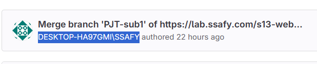

# 깃 관리 전략

상태: 완료
프로젝트: PJT 3 (https://www.notion.so/PJT-3-288cce47468a80e88544f852ebb5138d?pvs=21)

## git-flow 전략을 위한 깃 가이드

### 중요!: A408 브랜치 관리 가이드 요약

1. **기능 브랜치 이름은 feature/<본인 파트(BE,FE,RB)>/<기능 이름(ex:login-api)>**

    기능 브랜치는 반드시 develop로부터 생성해야합니다.(git branch 명령어를 반드시 develop에서 실행하라는 것)

    - ex: feature/BE/login-api

2. **커밋 제목 형식에 반드시 본인 파트를 스코프에 작성**

    파트별로 브랜치를 만들 수 없기 때문에 파트별로 커밋을 구분하기 위해 작성해야합니다.

3. **간단 요약**

    새로운 기능 만들때는 develop로부터 새 브랜치를 만들고 기능을 다 만들었으면 깃랩에서 develop으로 Merge Request를 신청하기
    

### git flow branch

1. **Git Flow 브랜치 전략**
    
    Git Flow는 `master`와 `develop` 두 개의 메인 브랜치를 중심으로, 목적에 따라 `feature`, `release`, `hotfix` 브랜치를 파생하여 사용하는 Git 브랜치 관리 전략
    
    ⇒ 상황에 맞게 브랜치를 만들거나 병합을 하면서 개발을 해야함
    
2. **핵심 브랜치 (Main Branches)**
    - **master (또는 main)**
        - **역할**: 제품 출시 버전(Production Ready)을 관리하는 브랜치.
        - **특징**: 가장 안정적인 상태의 코드만 포함하며, 배포 이력을 관리함.
        - **병합 소스**: `release` 브랜치와 `hotfix` 브랜치로부터만 병합됨.
    - **develop**
        - **역할**: 다음 버전 배포를 위한 개발을 진행하는 통합 브랜치.
        - **특징**: 모든 기능 개발의 기반이 되며, 비교적 안정적인 최신 개발 상태를 유지함.
        - **병합 소스**: `feature`, `release`, `hotfix` 브랜치로부터 병합됨.
3. **보조 브랜치 (Supporting Branches)**
    - **feature**
        - **역할**: 신규 기능 개발을 위한 브랜치.
        - **생성 위치**: `develop` 브랜치에서 분기함.
        - **병합 위치**: 개발 완료 후 `develop` 브랜치로 병합됨.
        - **네이밍**: `feature/login-api`, `feature/user-profile` 등 기능에 따라 명명함.
    - **release**
        - **역할**: 정식 버전 배포를 준비하기 위한 브랜치.
        - **생성 위치**: `develop` 브랜치에서 분기함.
        - **특징**: 버전 넘버링, 최종 버그 수정, 문서화 등 배포에 필요한 마무리 작업을 수행함. 신규 기능 추가는 금지됨.
        - **병합 위치**: 배포 준비 완료 후 `master`와 `develop` 브랜치 양쪽에 모두 병합됨.
    - **hotfix**
        - **역할**: 출시된 버전(`master`)에서 발생한 긴급 버그를 수정하기 위한 브랜치.
        - **생성 위치**: `master` 브랜치에서 분기함.
        - **특징**: 예측하지 못한 치명적 버그에 즉시 대응하기 위해 사용됨.
        - **병합 위치**: 수정 완료 후 `master`와 `develop` 브랜치 양쪽에 모두 병합됨.
4. **더 자세한 정보**
    
    https://velog.io/@myoungji-kim/git-flow
    

### 명령어 목록

1. 원격 브랜치 가져오기 및 연결하기
    1. 원격 브랜치 가져오기
        
        `git pull`
        
        pull을 할때 원격 저장소(깃랩 저장소)에 존재하는 브랜치도 같이 가져옵니다.
        
    2. 원격 저장소의 브랜치로 체크아웃 하기
        
        `git checkout -b <로컬-브랜치-이름> <원격-저장소-이름>/<원격-브랜치-이름>`
        
        가져온 원격 저장소의 브랜치와 연결된 로컬 브랜치를 생성하고 해당 브랜치로 체크아웃합니다.
        
        - ex: `git checkout -b BE_dev origin/BE_dev`
2. 로컬에서 만든 브랜치 올리기
    
    `git push -u origin <로컬 브랜치 이름>`
    
    로컬에서 만든 브랜치(기능 브랜치 등)을 원격 브랜치로 올리는 명령어
    
    - 주의: 브랜치는 로컬에서 만들어도 병합은 로컬에서 하면 안됨
3. 로컬 브랜치 삭제하기 (원격에 올리기 전)
    
    `git branch -d <삭제할-브랜치-이름>`
    
    실수로 만들었거나, 더 이상 필요 없는 로컬 브랜치를 삭제하는 명령어입니다. 다른 브랜치로 체크아웃한 상태에서 실행해야 합니다.
    
    - ex: `git branch -d feature/wrong-branch`
    - 주의: 병합하지 않은 변경 사항이 남아있는 브랜치는 경고 메시지와 함께 삭제되지 않습니다. 만약 강제로 삭제하려면 `D` 옵션을 사용하세요. (`git branch -D <브랜치-이름>`)
4. 커밋 히스토리 확인하기
    
    `git log`
    
    현재 브랜치의 커밋 내역을 시간순으로 보여줍니다. 각 커밋의 해시(ID), 작성자, 날짜, 커밋 메시지를 확인할 수 있습니다.
    
    - `q` 키를 눌러 로그 화면에서 빠져나올 수 있습니다.
    - 유용한 옵션:
        - `git log --oneline`: 각 커밋을 한 줄로 간결하게 보여줍니다.
        - `git log --graph`: 브랜치의 분기와 병합 내역을 그래프 형태로 보여줍니다.
5. 가장 최근 커밋 수정하기
    
    `git commit --amend`
    
    방금 한 가장 최근의 커밋을 수정하고 싶을 때 사용하는 명령어입니다. 주로 두 가지 상황에서 사용됩니다.
    
    1. **커밋 메시지 변경**: 명령어를 실행하면 편집기가 열리면서 가장 최근의 커밋 메시지를 수정할 수 있습니다.
    2. **파일 추가/누락**: 커밋에 빠뜨린 파일이 있을 때, 해당 파일을 `git add`로 추가한 뒤 이 명령어를 실행하면 새로운 커밋을 만드는 대신 기존 커밋에 변경사항을 덮어쓸 수 있습니다.
    - **매우 중요**: `amend`는 커밋 히스토리를 변경하는 작업이므로, **원격 저장소(GitLab)에 이미 push한 커밋에는 절대로 사용해서는 안 됩니다.** 오직 로컬 저장소에만 있는 커밋을 수정할 때 사용하세요.
6. 충돌 해결하기 (Merge Conflict)
    1. 특정 버전의 코드로 충돌 덮어쓰기
        
        충돌 발생 시, 특정 파일에 대해 한쪽 브랜치의 변경사항을 통째로 선택하여 덮어쓸 수 있습니다.
        
        - **내 버전(현재 브랜치)으로 덮어쓰기**
            
            `git checkout --ours <충돌이-발생한-파일-경로>`
            
            현재 내가 작업하던 브랜치(Our)의 내용으로 충돌 부분을 모두 덮어씁니다.
            
            - ex: `git checkout --ours auth.py`
        - **상대 버전(병합 대상 브랜치)으로 덮어쓰기**
            
            `git checkout --theirs <충돌이-발생한-파일-경로>`
            
            병합하려던 브랜치(Their)의 내용으로 충돌 부분을 모두 덮어씁니다.
            
            - ex: `git checkout --theirs auth.py`
        - 주의: 위 명령어를 실행한 뒤에는 반드시 `git add <파일>`로 스테이징하고 커밋해야 충돌 해결이 완료됩니다.
    2. 기타 충돌 해결에 유용한 명령어
        
        `git status`
        
        충돌이 발생한 파일 목록(`unmerged paths`)을 확인할 수 있습니다.
        
        `git diff`
        
        충돌이 발생한 파일들의 내용이 어떻게 다른지 자세히 비교해볼 수 있습니다.
        
        `git log --merge`
        
        충돌의 원인이 된 커밋들만 추려서 히스토리를 파악하는 데 도움이 됩니다.
        
        `git merge --abort`
        
        충돌 해결이 어렵거나 잘못되었을 때, merge를 시도하기 전 상태로 안전하게 되돌리는 "비상 탈출" 명령어입니다.
        

### 병합 가이드

1. **기본 가이드(주의 사항)**
    1. **절대 임의로 자신의 브랜치를 master 브랜치에 병합을 하지 마세요!**
    2. **절대로 로컬에서 임의로 병합을 하지 마세요!**
    
    ⇒ 반드시 모든 병합은 깃랩의 merge request로 신청해주세요.
    
2. **merge 커밋 템플릿**
    
    별도의 merge 커밋 양식은 사용하지 않고 깃랩의 기본 병합 커밋을 사용해주세요.
    
    ⇒ 아무것도 건들지 말고 기본 병합 커밋 메세지 그대로 사용하기
    

## 커밋 컨벤션

### 커밋 가이드

1. **📝 기본 양식**
    
    ```
    타입: 제목 또는 간단한 작업 내용 요약
    
    (선택) 본문: 한 줄 띄고 작성하며, 변경 사항이나 이유를 자세히 설명합니다.
    - 이런 식으로 불렛 포인트를 사용하면 가독성이 좋아집니다.
    ```
    
2. **핵심 타입 (이것만 기억해도 충분해요!)**
    - **feat**: 새로운 기능 추가 (가장 많이 사용)
    - **fix**: 버그 수정
    - **refactor**: 기능 변경 없이 코드 구조를 개선 (리팩토링)
    - **style**: 코드 포맷팅, 세미콜론 추가 등 (기능에 영향을 주지 않는 스타일 변경)
    - **docs**: README, 주석 등 문서 수정
    - **chore**: 빌드, 패키지 매니저 설정 등 기타 잡일
    
    > 💡 Tip: rename, remove 등은 refactor나 chore로 충분히 표현 가능하므로 초기에는 제외하여 혼동을 줄이는 것이 좋습니다.
    > 
3. **본문은 언제 필요한가?**
    
    **"커밋 제목(첫 줄)만으로는 변경 내용을 충분히 설명할 수 없을 때"** 본문을 작성
    
4. **실제 적용 예시**
    1. 예시 1: 간단한 기능 추가 (제목만 사용)
        
        ```
        feat: 소셜 로그인 버튼 UI 추가
        ```
        
    2. 예시 2: 버그 수정 (본문 포함)
        
        ```
        fix: 회원가입 시 이메일 중복 체크 오류 수정
        
        - 기존에는 API 요청 후 응답 값을 제대로 처리하지 못해, 중복된 이메일로도 가입이 가능했음.
        - 비동기 처리 로직을 수정하여 서버 응답을 정확히 확인하도록 변경.
        ```
        
    3. 예시 3: 문서 수정
        
        ```
        docs: README.md 파일에 프로젝트 실행 방법 추가
        ```
        

### 커밋 양식

```
타입: 제목

# (선택) 본문: 한 줄 띄고 작성하며, 변경 사항이나 이유를 자세히 설명합니다.
- 이런 식으로 불렛 포인트를 사용하면 가독성이 좋아집니다.

# --- COMMIT END ---  
#   <타입> 리스트  
#   feat        : 기능 (새로운 기능)  
#   fix         : 버그 (버그 수정)  
#   refactor    : 리팩토링  
#   design      : CSS 등 사용자 UI 디자인 변경  
#   comment     : 필요한 주석 추가 및 변경  
#   style       : 스타일 (코드 형식, 세미콜론 추가: 비즈니스 로직에 변경 없음)  
#   docs        : 문서 수정 (문서 추가, 수정, 삭제, README)  
#   test        : 테스트 (테스트 코드 추가, 수정, 삭제: 비즈니스 로직에 변경 없음)  
#   chore       : 기타 변경사항 (빌드 스크립트 수정, assets, 패키지 매니저 등)  
#   init        : 초기 생성  
#   rename      : 파일 혹은 폴더명을 수정하거나 옮기는 작업만 한 경우  
#   remove      : 파일을 삭제하는 작업만 수행한 경우  
# ------------------
```

## 깃 사용 가이드

### 사용자 설정

1. **개요**
    
    
    
    컴퓨터 내부 이름이 아닌 사용자의 이름이 등록되어야한다.
    
    깃 저장소를 클론해서 커밋을 하고 푸쉬를 할 때 사용자 설정을 잘못한다면 위와 같이 이상한 이름으로 사용자 표시가 되는 경우가 발생합니다.
    
2. **현재 사용자 확인**
    
    
    
    `git config -l`을 통해 현재 저장소를 사용하는 사용자를 확인 할 수 있습니다.
    
    ⇒ 해당 정보가 커밋에도 포함되니 꼭 확인해주세요.
    
3. **사용자 설정**
    
    ```
    git config (--global) user.email ‘깃랩 계정 이메일’
    git config (--global) user.name ‘본인 이름’
    ```
    
    사용자 정보가 등록되어있지 않다면 수정해주세요.
    
4. **깃 접근 토큰 발급**
    
    
    
    
    
    
    클론이나 푸쉬를 할때 인증정보를 입력해야되는 경우 PW에 SSAFY 계정의 PW가 아니라 발급받은 토큰을 입력해야됩니다. 
    

### 주의사항

1. **—force 금지**
    
    뭔가 안된다고 —force를 사용하면 안됩니다.
    
    ⇒ 문제가 생기면 깃 관리자에게 이야기를 해주세요.
    
2. **병합 충돌(conflict) 해결시 주의사항**
    
    
    
    개발을 하다보면 여러가지 충돌 상황이 생기는데 이러한 경우에는 사람이 직접 충돌하는 코드를 보고 어떤 코드를 사용할지 결정해야합니다.
    
    ⇒ 이때 잘못된 코드를 선택하면 많이 귀찮아지니 잘 모르면 깃 관리자한테 질문하세요.
    
    - 관련된 유용한 명령어
        
        명령어 목록 참고 6번 참고