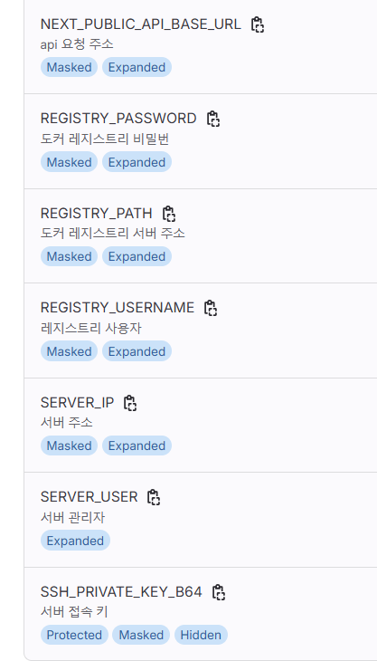

# 포팅 메뉴얼

상태: 시작 전
프로젝트: PJT 3 (https://www.notion.so/PJT-3-288cce47468a80e88544f852ebb5138d?pvs=21)

## 도커 빌드

### 도커 컨테이너 수동 배포

1. 사전 준비
    
    배포할 서버에 도커 이미지를 저장하는 registy를 설치해주세요.(하단의 docker 환경 설정 참고)
    
2. `*_depl.bat`스크립트 수정
    
    수동 배포 스크립트의 `SSH_KEY_PATH`환경 변수를 배포 서버의 ssh 키가 있는 경로로 수정해주세요.
    
3. 스크립트 실행
    
    배치 스크립트를 실행하면 로컬에서 도커 이미지가 빌드되어 배포 서버의 registry로 업로드 되고 ssh를 통해 최신 이미지로 서버를 실행합니다.
    

### 깃랩 CI/CD 기반 배포 자동화

깃랩 CI/CD 기능을 활용하여 배치 스크립트에서 하는 작업을 깃랩에서 자동화하게 할 수 있습니다.

1. CI/CD 스크립트(.gitlab-ci.yml)
    
    ```
    # 파이프라인의 전체 단계를 정의합니다. build -> deploy 순서로 실행됩니다.
    stages:
      - build
      - deploy
    
    # 공통 설정을 템플릿으로 분리
    .build_template: &build_configuration
      stage: build
      image: docker:20.10.16
      services:
        - name: docker:20.10.16-dind
          command: ["--insecure-registry=k13a408.p.ssafy.io:5000"]
      variables:
        DOCKER_TLS_CERTDIR: ""
      before_script:
        - echo "$REGISTRY_PASSWORD" | docker login -u "$REGISTRY_USERNAME" --password-stdin k13a408.p.ssafy.io:5000
      tags:
        - docker
    
    build_frontend:
      <<: *build_configuration # 템플릿 적용
      script:
        - echo "프론트엔드 빌드 & 푸시..."
        - docker build --build-arg NEXT_PUBLIC_API_BASE_URL=https://k13a408.p.ssafy.io/api -t k13a408.p.ssafy.io:5000/okey_ducky_front:latest -f FrontEnd/Dockerfile FrontEnd
        - docker push k13a408.p.ssafy.io:5000/okey_ducky_front:latest
      rules:
        - if: '$CI_COMMIT_BRANCH == "master" || $CI_COMMIT_BRANCH == "develop"'
          changes:
            - FrontEnd/**/*
    
    build_backend:
      <<: *build_configuration # 템플릿 적용
      script:
        - echo "백엔드 빌드 & 푸시..."
        - docker build --build-arg NEXT_PUBLIC_API_BASE_URL=$NEXT_PUBLIC_API_BASE_URL -t k13a408.p.ssafy.io:5000/okey_ducky_web:latest -f BackEnd/dockerfile.web BackEnd
        - docker push k13a408.p.ssafy.io:5000/okey_ducky_web:latest
      rules:
        - if: '$CI_COMMIT_BRANCH == "master" || $CI_COMMIT_BRANCH == "develop"'
          changes:
            - BackEnd/**/*
    
    build_ai:
      <<: *build_configuration # 템플릿 적용
      script:
        - echo "ai 서버 빌드 & 푸시..."
        - docker build --build-arg NEXT_PUBLIC_API_BASE_URL=$NEXT_PUBLIC_API_BASE_URL -t k13a408.p.ssafy.io:5000/okey_ducky_ai:latest -f BackEnd/dockerfile.ai BackEnd
        - docker push k13a408.p.ssafy.io:5000/okey_ducky_ai:latest
      rules:
        - if: '$CI_COMMIT_BRANCH == "master" || $CI_COMMIT_BRANCH == "develop"'
          changes:
            - BackEnd/**/*
    
    # 실제 배포 스테이지 (SSH를 이용한 배포)
    deploy_to_server:
      stage: deploy
      image: alpine:latest
      before_script:
        # SSH 클라이언트 설치 및 개인키 설정 (GitLab CI/CD Variables에 SSH_PRIVATE_KEY 등록 필요)
        - apk add --no-cache openssh-client
        - eval $(ssh-agent -s)
        - echo "$SSH_PRIVATE_KEY_B64" | base64 -d | ssh-add -
        - mkdir -p ~/.ssh
        - chmod 700 ~/.ssh
        - echo -e "Host *\n\tStrictHostKeyChecking no\n\n" > ~/.ssh/config
      script:
        - echo "서버에 배포를 시작합니다..."
        # 서버에 접속하여 docker-compose 등으로 최신 이미지 실행
        - ssh $SERVER_USER@$SERVER_IP "cd ~/okey_ducky_env && sudo docker login -u $REGISTRY_USERNAME -p $REGISTRY_PASSWORD k13a408.p.ssafy.io:5000 && sudo docker compose pull && sudo docker compose up -d"
      only:
        - master 
        - develop # 작업 내용을 즉시 확인가능하도록 ec2에도 바로 반영영
      tags:
        - docker 
    
    ```
    
2. 깃랩 환경 변수
    
    
    

## 도커 컨테이너 관리: docker compose

### 실행 환경

1. 디렉토리 설정
    
    ```
    .
    ├── db
    │   └── redis
    ├── docker
    │   ├── auth
    │   │   └── htpasswd
    │   ├── registry
    │   └── secure
    │       └── .env            # BackEnd, AI 서버 실행을 위한 환경변수
    ├── docker-compose.yml
    ├── .env                    # docker compose 실행을 위한 환경변수
    ├── docs
    │   └── okey_ducky_api.yml
    └── proxy
        └── nginx.conf
    ```
    
    도커 컴포즈를 실행할 디렉토리를 위와 같이 설정해주세요
    
2. 도커 컴포즈 실행을 위한 환경 변수 설정
    
    ```
    BASE_DIR=/home/ubuntu/okey_ducky_env # 작업 디렉토리 전체 경로
    
    WEB_PORT=8000
    AI_PORT=8001
    
    REGISTRY_PORT=5000
    REGISTRY_UI_PORT=5001
    
    REDIS_HOST='호스트 주소'
    REDIS_PORT='레디스 포트'
    REDIS_PASSWORD='레디스 비밀번호'
    ```
    

### `docker-compose.yml`

```
networks:
  okey-network:
    driver: bridge

services:
  proxy:
    image: nginx:latest
    container_name: nginx_proxy
    ports:
      - "80:80"
      - "443:443"
    volumes:
      - ${BASE_DIR}/proxy/nginx.conf:/etc/nginx/conf.d/default.conf
      - /etc/letsencrypt:/etc/letsencrypt:ro
    networks:
      - okey-network
    restart: unless-stopped

  okey_web:
    image: k13a408.p.ssafy.io:5000/okey_ducky_web:latest
    container_name: okey_web
    ports: 
      - "${WEB_PORT}:${WEB_PORT}"
    env_file:
      - ${BASE_DIR}/docker/secure/.env
    networks:
      - okey-network
    restart: unless-stopped

  okey_ai:
    image: k13a408.p.ssafy.io:5000/okey_ducky_ai:latest
    container_name: okey_ai
    # expose:
    #   - ${AI_PORT}
    ports:
      - "${AI_PORT}:${AI_PORT}"
    env_file:
      - ${BASE_DIR}/docker/secure/.env
    networks:
      - okey-network
    restart: unless-stopped
    depends_on:
      - okey_web
  
  okey_front:
    image: k13a408.p.ssafy.io:5000/okey_ducky_front:latest
    container_name: okey_front
    networks:
      - okey-network
    restart: unless-stopped

  api-docs:
    image: swaggerapi/swagger-ui:latest
    container_name: api_docs
    volumes:
      - ${BASE_DIR}/docs/okey_ducky_api.yml:/usr/share/nginx/html/okey_ducky_api.yml
    environment:
      - URL=okey_ducky_api.yml
    ports: 
      - "8080"
    networks:
      - okey-network
    restart: unless-stopped
  
  redis:
    image: redis:7-alpine
    container_name: project_redis
    restart: unless-stopped
    ports:
      - "${REDIS_PORT}:${REDIS_PORT}"
    command: >
      redis-server 
      --appendonly yes 
      --requirepass ${REDIS_PASSWORD}
    volumes:
      - ${BASE_DIR}/db/redis:/data
    networks:
      - okey-network
      
  registry:
    image: registry:2
    container_name: registry
    ports:
      - "${REGISTRY_PORT}:${REGISTRY_PORT}" 
    volumes:
      - ${BASE_DIR}:/var/lib/registry
      - ${BASE_DIR}/docker/auth:/auth
      - /etc/letsencrypt:/etc/letsencrypt:ro 
    environment:
      - REGISTRY_AUTH=htpasswd
      - REGISTRY_AUTH_HTPASSWD_REALM="Registry Realm"
      - REGISTRY_AUTH_HTPASSWD_PATH=/auth/htpasswd
      - REGISTRY_STORAGE_DELETE_ENABLED=true
      - REGISTRY_HTTP_TLS_CERTIFICATE=/etc/letsencrypt/live/k13a408.p.ssafy.io/fullchain.pem
      - REGISTRY_HTTP_TLS_KEY=/etc/letsencrypt/live/k13a408.p.ssafy.io/privkey.pem
      - REGISTRY_HTTP_HEADERS_Access-Control-Allow-Origin=['http://k13a408.p.ssafy.io:5001']
      - REGISTRY_HTTP_HEADERS_Access-Control-Allow-Methods=['HEAD', 'GET', 'OPTIONS', 'DELETE']
      - REGISTRY_HTTP_HEADERS_Access-Control-Allow-Headers=['Authorization', 'Accept']
      - REGISTRY_HTTP_HEADERS_Access-Control-Allow-Credentials=['true']
    networks:
      - okey-network
    restart: unless-stopped
    profiles:
      - "dev-util"

  registry-ui:
    image: joxit/docker-registry-ui:latest
    container_name: registry_ui
    ports:
      - "${REGISTRY_UI_PORT}:80"
    environment:
      - SINGLE_REGISTRY=true
      - REGISTRY_TITLE="Okey Ducky Registry"
      - DELETE_IMAGES=true
      - REGISTRY_URL=https://k13a408.p.ssafy.io:${REGISTRY_PORT}
    networks:
      - okey-network
    depends_on:
      - registry
    restart: unless-stopped
    profiles:
      - "dev-util"
```

## 백엔드 서버 설정

### nginx

```
#./proxy/nginx.conf
server {
    listen 80;
    server_name k13a408.p.ssafy.io;
    # 모든 HTTP 요청을 HTTPS로 보냅니다.
    return 301 https://$host$request_uri;
}

server {
    listen 443 ssl;
    server_name k13a408.p.ssafy.io localhost;

    # SSL/TLS 인증서 설정
    ssl_certificate /etc/letsencrypt/live/k13a408.p.ssafy.io/fullchain.pem;
    ssl_certificate_key /etc/letsencrypt/live/k13a408.p.ssafy.io/privkey.pem;

    # SSL 보안 강화 설정 (권장)
    ssl_protocols TLSv1.2 TLSv1.3;
    ssl_ciphers ECDHE-ECDSA-AES128-GCM-SHA256:ECDHE-RSA-AES128-GCM-SHA256:ECDHE-ECDSA-AES256-GCM-SHA384:ECDHE-RSA-AES256-GCM-SHA384:ECDHE-ECDSA-CHACHA20-POLY1305:ECDHE-RSA-CHACHA20-POLY1305:DHE-RSA-AES128-GCM-SHA256:DHE-RSA-AES256-GCM-SHA384;
    ssl_prefer_server_ciphers off;
    
    client_max_body_size 50M;

    # ================================================================
    # 백엔드 API 서버 (/api/)
    # ================================================================
    location /api/ {
        proxy_pass http://okey_web:8000/;
        proxy_set_header Host $host;
        proxy_set_header X-Real-IP $remote_addr;
        proxy_set_header X-Forwarded-For $proxy_add_x_forwarded_for;
        proxy_set_header X-Forwarded-Proto $scheme;
    }

    # ================================================================
    # Socket.IO 웹소켓을 위한 설정 (이 부분을 추가하세요!)
    # ================================================================
    location /socket.io {
        proxy_pass http://okey_web:8000; # API 서버와 동일한 백엔드
        proxy_http_version 1.1;
        proxy_set_header Upgrade $http_upgrade;
        proxy_set_header Connection "upgrade";
        proxy_set_header Host $host;
        proxy_cache_bypass $http_upgrade;
    }

    #================================================================
    # Swagger API 문서 (/docs/) # 개발자용
    #================================================================
    location /docs/ {
        rewrite ^/docs/(.*)$ /$1 break;
        proxy_pass http://api_docs:8080;
        proxy_set_header Host $host;
        proxy_set_header X-Real-IP $remote_addr;
        proxy_set_header X-Forwarded-For $proxy_add_x_forwarded_for;
        proxy_set_header X-Forwarded-Proto $scheme;
    }

    #================================================================
    # 도커 레지스트리 UI (/registry/) #개발자 용도로 사용
    #================================================================
    # location /registry/ {
    #     rewrite ^/registry/(.*)$ /$1 break;
    #     proxy_pass http://registry-ui:80;
    #     proxy_set_header Host $host;
    #     proxy_set_header X-Real-IP $remote_addr;
    #     proxy_set_header X-Forwarded-For $proxy_add_x_forwarded_for;
    #     proxy_set_header X-Forwarded-Proto $scheme;
    # }

    location / {
        # API 및 웹소켓과 동일한 백엔드 서버로 요청을 보냅니다.
        # 이 백엔드 서버가 'dist/index.html' 파일을 서빙합니다.
        proxy_pass http://okey_front:3000;

        # 일반적인 프록시 헤더 설정
        proxy_set_header Host $host;
        proxy_set_header X-Real-IP $remote_addr;
        proxy_set_header X-Forwarded-For $proxy_add_x_forwarded_for;
        proxy_set_header X-Forwarded-Proto $scheme;
    }
}
```

### 서버 환경 변수

```
DEBUG=True
MAIN_SERV_PORT=8000

DB_NAME=s13p31a408
DB_ROOT_USER=S13P31A408
DB_ROOT_PW='DB 패스워드'
DB_HOST='DB 주소'
DB_SSL_CONFIG='{"ssl_true": true}'
MYSQL_PORT=3306

BACKEND_URL=http://okey_web:8000
AI_SERVER_URL=http://okey_ai:8001
MAIN_SERV_PORT=8000
AI_SERV_PORT=8001

REDIS_HOST='레디스 호스트 주소'
REDIS_PORT='도커 컴포즈에서 설정한 레디스 포트'
REDIS_PASSWORD='도커 컴포즈에서 설정한 레디스 패스워드'

SESSION_EXPIRE_SECONDS=86400
SDP_EXPIRATION_SECONDS=300

API_KEY_LEN=32
ACCESS_TOKEN_EXPIRE_MINUTES=720
ENC_ALGORITHM=HS25
SECRET_KEY='암호화에 사용할 비밀키

AI_BASE_URL='AI 제공 서버'
OPENAI_API_KEY='AI 서비스 api 키'
```
### 사용한 외부 서비스

1. OpneAI api
    
    llm, tts 서비스 활용
    
2. azure ai speech
    
    stt 서비스 활용